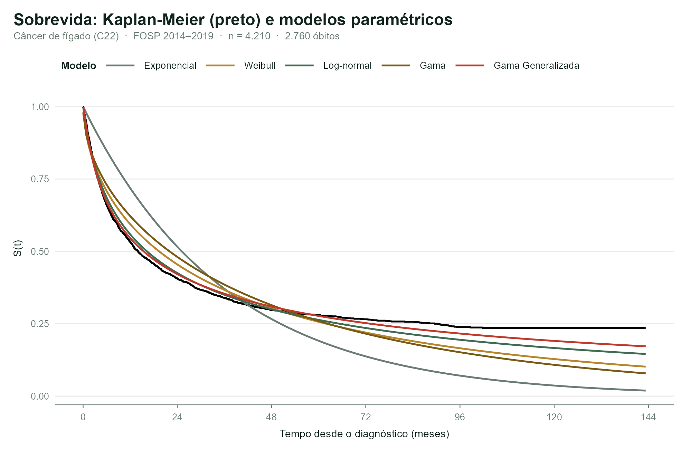
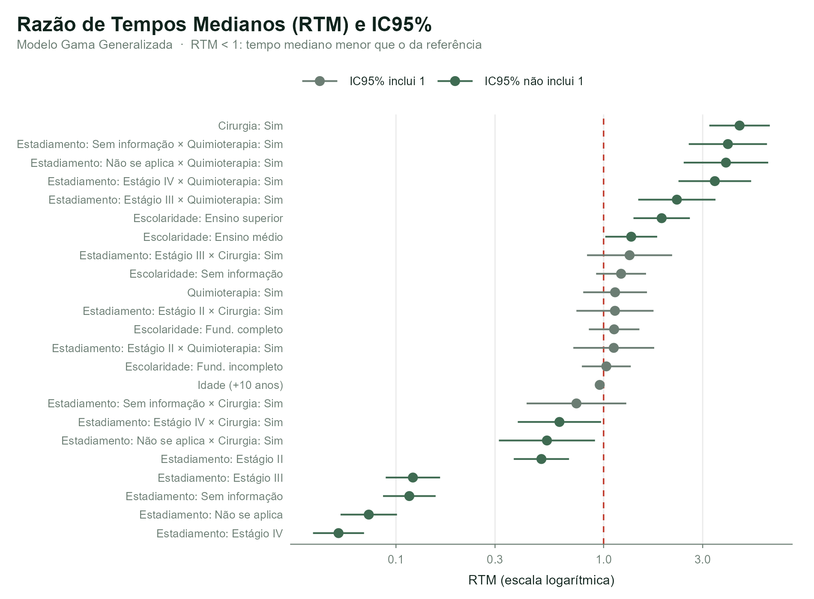
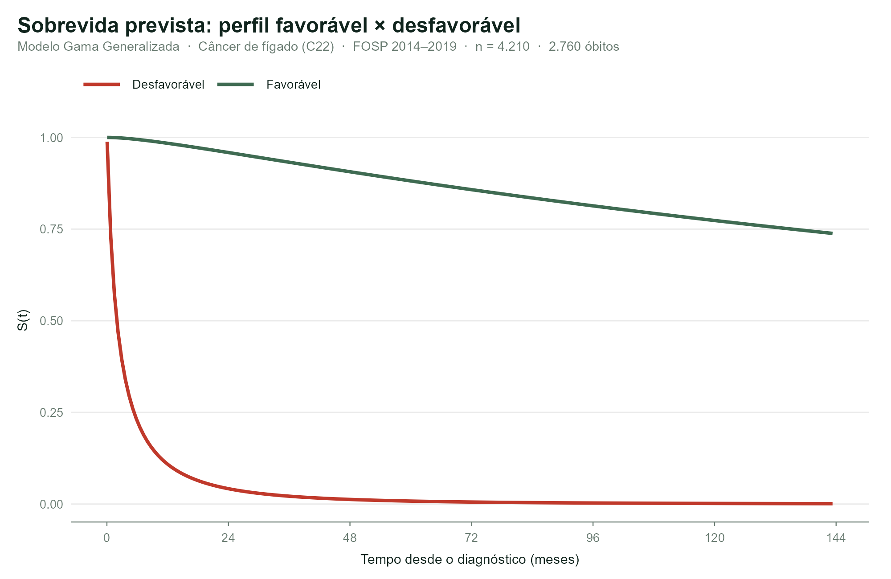

```{r}
#| include: false
library(flexsurv)   # métodos coef() e vcov() do modelo final

base <- readRDS("data/base_analitica.RDS")
med  <- format(round(base$mediana_km, 1), decimal.mark = ",")

f2 <- function(x) formatC(x, format = "f", digits = 2, decimal.mark = ",")

# RTM combinada da QUIMIO (efeito principal x interação com o estágio), IC95% pela
# matriz de covariância. Se o cálculo falhar, usa as estimativas pontuais do console.
comb <- tryCatch({
  m <- readRDS("data/modelo_final.RDS")
  b <- coef(m)
  V <- vcov(m)
  if (is.null(rownames(V))) dimnames(V) <- list(names(b), names(b))
  est_ic <- function(nm) {
    e  <- sum(b[nm])
    se <- sqrt(sum(V[nm, nm, drop = FALSE]))
    exp(e + c(0, -1, 1) * qnorm(0.975) * se)
  }
  estagios <- c("Estágio I", "Estágio II", "Estágio III", "Estágio IV")
  qui <- t(sapply(estagios, function(e) {
    est_ic(c("QUIMIOSim", if (e != "Estágio I") paste0("ECGRUP", e, ":QUIMIOSim")))
  }))
  list(qui = qui)
}, error = function(e) NULL)

if (is.null(comb)) comb <- list(qui = cbind(c(1.11, 1.23, 2.48, 3.96), NA, NA))
tem_ic <- !any(is.na(comb$qui))

tab_comb <- function(M) {
  g   <- "grid-template-columns:.7fr 1.7fr 1.5fr;"
  cab <- paste0('<div class="lin lin-h" style="', g,
                '"><span>Estágio</span><span>RTM (IC95%)</span><span>Leitura</span></div>')
  nomes <- c("I", "II", "III", "IV")
  linhas <- vapply(1:4, function(i) {
    r   <- unname(M[i, ])
    rtm <- if (is.na(r[2])) f2(r[1]) else sprintf("%s (%s–%s)", f2(r[1]), f2(r[2]), f2(r[3]))
    leit <- if (is.na(r[2])) '<span class="tg tg-ref">estimativa pontual</span>'
            else if (r[2] > 1) '<span class="tg tg-ok">maior tempo mediano</span>'
            else if (r[3] < 1) '<span class="tg tg-no">menor tempo mediano</span>'
            else '<span class="tg tg-ref">IC inclui 1</span>'
    paste0('<div class="lin" style="', g, '"><b>', nomes[i], '</b><b>', rtm, '</b>', leit, '</div>')
  }, character(1))
  paste0(cab, paste(linhas, collapse = ""))
}

nota_comb <- if (tem_ic) {
  "RTM combinada = efeito principal × interação, com IC95% pela matriz de covariância do modelo."
} else {
  "Estimativas pontuais (produto dos efeitos); IC indisponível nesta renderização."
}
qui_iv <- if (tem_ic) sprintf("%s (%s–%s)", f2(comb$qui[4, 1]), f2(comb$qui[4, 2]), f2(comb$qui[4, 3])) else "≈ 3,96"

# "Sem informação" no estadiamento: lido do modelo final (tabelas_parte2.RDS)
rtm_tab <- tryCatch(readRDS("data/tabelas_parte2.RDS")$rtm, error = function(e) NULL)
get_rtm <- function(termo) if (is.null(rtm_tab)) NA_real_ else rtm_tab$RTM[match(termo, rtm_tab$Termo)]
si  <- get_rtm("ECGRUPSem informação")
iii <- get_rtm("ECGRUPEstágio III")
callout_si <- if (is.na(si) || is.na(iii)) "" else if (abs(log(si / iii)) < 0.25) {
  sprintf('<div class="callout callout-ok"><b>"Sem informação" no estadiamento</b> tem RTM %s, semelhante ao estágio III (%s): não são dados ao acaso, o que <b>justifica mantê-los</b> como categoria.</div>', f2(si), f2(iii))
} else {
  sprintf('<div class="callout callout-ok"><b>"Sem informação" no estadiamento</b> tem RTM %s (estágio III: %s): categoria com prognóstico próprio, <b>mantida separada</b>.</div>', f2(si), f2(iii))
}
```

# Introdução

## Retomada da Parte I

:::: {.columns}
::: {.column width="49%"}
<div class="c-g">
<h3 class="ttl">O que a Parte I estabeleceu</h3>
<div class="g2">
<div class="in-g"><div class="lbl">👥 Pacientes</div><div class="big" style="color:#3f6b52;">4.231</div><div class="sub">C22 · FOSP · 2014–2019</div></div>
<div class="in-g"><div class="lbl">💀 Óbitos por câncer</div><div class="big" style="color:#3f6b52;">2.774</div><div class="sub">65,6% · evento de interesse</div></div>
<div class="in-g"><div class="lbl">⏱️ Mediana global</div><div class="big" style="color:#3f6b52;">13,9</div><div class="sub">meses de sobrevida</div></div>
<div class="in-g"><div class="lbl">🚫 Censuras</div><div class="big" style="color:#3f6b52;">1.457</div><div class="sub">34,4% · sem óbito por câncer</div></div>
</div>
</div>
:::
::: {.column width="2%"}
:::
::: {.column width="49%"}
<div class="c-d">
<h3 class="ttl">Por que uma Parte II?</h3>
<div class="in-d"><div class="lbl">Parte I</div><div class="txt">Análise <b>univariada e não paramétrica</b>: estadiamento, escolaridade e cirurgia separaram as curvas.</div></div>
<div class="in-d"><div class="lbl">Limite</div><div class="txt">Cada fator foi avaliado isoladamente; os efeitos <b>se sobrepõem</b> e não foram separados entre si.</div></div>
<div class="in-d"><div class="lbl">Pergunta da Parte II</div><div class="txt">Qual <b>distribuição</b> descreve o tempo até o óbito e quais <b>covariáveis</b> continuam importantes quando analisadas em conjunto?</div></div>
</div>
:::
::::

## Objetivo

:::: {.columns}
::: {.column width="49%"}
<div class="c-g">
<div class="item"><div class="num">I</div><h3 class="ttl">Sem covariáveis</h3></div>
<div class="txt"><b>Qual distribuição</b> descreve o tempo até o óbito por câncer de fígado?</div>
<div style="display:flex; flex-wrap:wrap; gap:8px;">
<span class="pill">Exponencial</span><span class="pill">Weibull</span><span class="pill">Log-normal</span><span class="pill">Gama</span><span class="pill">Gama Generalizada</span>
</div>
<div class="sub">Escolha por gráficos, AIC/BIC e Teste da Razão de Verossimilhanças</div>
</div>
:::
::: {.column width="2%"}
:::
::: {.column width="49%"}
<div class="c-d">
<div class="item"><div class="num num-d">II</div><h3 class="ttl">Com covariáveis</h3></div>
<div class="txt"><b>Quais fatores</b> permanecem no modelo e <b>quanto</b> mudam o tempo de sobrevida?</div>
<div style="display:flex; flex-wrap:wrap; gap:8px;">
<span class="pill pill-d">Seleção de variáveis</span><span class="pill pill-d">Diagnóstico</span><span class="pill pill-d">Razão de tempos medianos</span>
</div>
<div class="sub">Interpretação em termos de tempo mediano de sobrevida</div>
</div>
:::
::::

# Metodologia

## Etapa I · Escolha da Distribuição

:::: {.columns}
::: {.column width="49%"}
<div class="c-g">
<h3 class="ttl">Modelos ajustados</h3>
<div class="in-g item"><div class="num">1</div><div style="flex:1;"><span class="fn">dist = "exponential"</span> <b class="txt">Exponencial</b></div></div>
<div class="in-g item"><div class="num">2</div><div style="flex:1;"><span class="fn">dist = "weibull"</span> <b class="txt">Weibull</b></div></div>
<div class="in-g item"><div class="num">3</div><div style="flex:1;"><span class="fn">dist = "lnorm"</span> <b class="txt">Log-normal</b></div></div>
<div class="in-g item"><div class="num">4</div><div style="flex:1;"><span class="fn">dist = "gamma"</span> <b class="txt">Gama</b></div></div>
<div class="in-g item"><div class="num">5</div><div style="flex:1;"><span class="fn">dist = "gengamma"</span> <b class="txt">Gama Generalizada</b></div></div>
<div class="sub">Todos ajustados com <span class="fn">flexsurvreg()</span></div>
</div>
:::
::: {.column width="2%"}
:::
::: {.column width="49%"}
<div class="c-d">
<h3 class="ttl">Critérios de escolha</h3>
<div class="in-d"><div class="txt"><b>Kaplan-Meier × modelo</b> · pontos próximos da diagonal indicam bom ajuste</div></div>
<div class="in-d"><div class="txt"><b>Linearização</b> · reta indica adequação (Exponencial, Weibull, Log-normal)</div></div>
<div class="in-d"><div class="txt"><b>AIC e BIC</b> · menor valor, ajuste penalizado pela complexidade</div></div>
<div class="in-d"><div class="txt"><b>TRV</b> · cada modelo contra a Gama Generalizada (modelos aninhados)</div></div>
<div class="sub">A decisão combina os quatro critérios; em caso de dúvida, o modelo mais simples</div>
</div>
:::
::::

## Etapa II · Seleção de Variáveis

<div class="c-k" style="margin-bottom:14px;">
<div class="lbl" style="color:#d9b054;">Os 5 passos de seleção · TRV a 10% + BIC</div>
</div>
<div class="fluxo">
<div class="passo"><div class="lbl">Passo 1</div><div class="txt"><b>Uma a uma</b> contra o modelo nulo</div></div>
<div class="seta">▶</div>
<div class="passo"><div class="lbl">Passo 2</div><div class="txt"><b>Modelo múltiplo</b>, retirando uma por vez</div></div>
<div class="seta">▶</div>
<div class="passo"><div class="lbl">Passo 3</div><div class="txt"><b>Reentrada</b> das descartadas</div></div>
<div class="seta">▶</div>
<div class="passo"><div class="lbl">Passo 4</div><div class="txt"><b>Reavaliação</b> das excluídas no passo 1</div></div>
<div class="seta">▶</div>
<div class="passo"><div class="lbl">Passo 5</div><div class="txt"><b>Interações</b> (até duas)</div></div>
</div>
<div style="height:14px;"></div>

:::: {.columns}
::: {.column width="49%"}
<div class="c-g">
<h3 class="ttl">Antes do passo 1</h3>
<div class="in-g"><div class="txt"><b>Filtro:</b> p &lt; 0,25 no Log-Rank ou no Peto-Peto</div></div>
<div class="in-g"><div class="txt"><b>Candidatas:</b> 6, com justificativa clínica</div></div>
<div class="in-g"><div class="txt"><b>Ajuste inicial:</b> Gama Generalizada, depois trocada pela distribuição escolhida</div></div>
<div class="in-g"><div class="txt"><b>Mesma amostra</b> em todos os modelos comparados</div></div>
</div>
:::
::: {.column width="2%"}
:::
::: {.column width="49%"}
<div class="c-d">
<h3 class="ttl">Regra de decisão</h3>
<div class="in-d"><div class="txt">Entra/fica se <b>p (TRV) &lt; 0,10 E ΔBIC &gt; 0</b></div></div>
<div class="in-d"><div class="txt"><b>ΔBIC = BIC(sem o termo) − BIC(com o termo)</b>; positivo favorece manter o termo</div></div>
<div class="in-d"><div class="txt">Com n = 4.210, o BIC penaliza ≈ 8,3 por parâmetro e <b>evita reter efeitos triviais</b> que o p-valor sozinho aprovaria</div></div>
</div>
:::
::::

## Etapa II · Avaliação e Interpretação

:::: {.columns}
::: {.column width="32%"}
<div class="c-g">
<h3 class="ttl">Distribuição final</h3>
<div class="in-g"><div class="txt">Mesmos critérios da Etapa I, agora <b>com covariáveis</b></div></div>
<div><span class="fn">&#36;AIC</span> <span class="fn">&#36;BIC</span> <span class="fn">TRV</span></div>
</div>
:::
::: {.column width="2%"}
:::
::: {.column width="32%"}
<div class="c-d">
<h3 class="ttl">Diagnóstico</h3>
<div class="in-d"><div class="txt"><b>Cox-Snell</b> · risco acumulado dos resíduos sobre a reta</div></div>
<div class="in-d"><div class="txt"><b>Quantílico aleatorizado</b> · qq-plot com banda de confiança</div></div>
</div>
:::
::: {.column width="2%"}
:::
::: {.column width="32%"}
<div class="c-g">
<h3 class="ttl">Interpretação</h3>
<div class="in-g"><div class="txt"><b>RTM</b> · razão de tempos medianos, com IC95%</div></div>
<div class="in-g"><div class="txt">Exponencial e Gama usam <span class="fn">exp(-coef)</span>; as demais <span class="fn">exp(coef)</span></div></div>
<div class="sub">Interações: efeitos lidos em conjunto</div>
</div>
:::
::::

# Resultados

## Etapa I · Kaplan-Meier × Modelos

<div class="msg"><span class="msg-k">Leitura</span><span>Quanto mais próximos da diagonal, melhor o ajuste: a <b>Gama Generalizada</b> é a que mais se aproxima; a <b>exponencial</b> é a que mais se afasta.</span></div>

::: {.plot}
{height=430}
:::

## Etapa I · Linearização

<div class="msg"><span class="msg-k">Leitura</span><span>A <b>exponencial</b> sai claramente da reta; Weibull e log-normal ficam mais próximas, mas com desvios nas caudas. Gama e Gama Generalizada não têm linearização.</span></div>

::: {.plot}
{width=100%}
:::

## Etapa I · AIC e BIC

<div class="msg"><span class="msg-k">Resultado</span><span><b>Gama Generalizada</b> tem o menor AIC e o menor BIC; a log-normal, a segunda melhor, fica <b>41 pontos de AIC</b> acima.</span></div>

:::: {.columns}
::: {.column width="44%"}
<div class="c-g">
<h3 class="ttl">Critérios de informação</h3>
<div class="lin lin-h" style="grid-template-columns:1.7fr 1fr 1fr .9fr;"><span>Modelo</span><span>AIC</span><span>BIC</span><span>ΔAIC</span></div>
<div class="lin lin-best" style="grid-template-columns:1.7fr 1fr 1fr .9fr;"><span>Gama Generalizada</span><span>23.469,4</span><span>23.488,5</span><span>0</span></div>
<div class="lin" style="grid-template-columns:1.7fr 1fr 1fr .9fr;"><span>Log-normal</span><span>23.510,9</span><span>23.523,6</span><span>+41,4</span></div>
<div class="lin" style="grid-template-columns:1.7fr 1fr 1fr .9fr;"><span>Weibull</span><span>23.942,7</span><span>23.955,3</span><span>+473,2</span></div>
<div class="lin" style="grid-template-columns:1.7fr 1fr 1fr .9fr;"><span>Gama</span><span>24.182,5</span><span>24.195,1</span><span>+713,0</span></div>
<div class="lin" style="grid-template-columns:1.7fr 1fr 1fr .9fr;"><span>Exponencial</span><span>25.344,7</span><span>25.351,0</span><span>+1.875,2</span></div>
<div class="sub">Ordenado por AIC; a ordem pelo BIC é a mesma.</div>
</div>
:::
::: {.column width="2%"}
:::
::: {.column width="54%"}
::: {.plot}
{width=100%}
:::
:::
::::

## Etapa I · Teste da Razão de Verossimilhanças

<div class="msg"><span class="msg-k">Resultado</span><span>Com n = 4.210, o TRV detecta até desvios pequenos: <b>todos os modelos simples são rejeitados</b>. A log-normal é a mais próxima (TRV = 43,4).</span></div>

<div class="c-d">
<h3 class="ttl">Cada modelo contra a Gama Generalizada</h3>
<div class="lin lin-h" style="grid-template-columns:1.6fr 1fr .6fr 1fr 1.3fr;"><span>Comparação</span><span>TRV</span><span>gl</span><span>p-valor</span><span>Decisão (5%)</span></div>
<div class="lin" style="grid-template-columns:1.6fr 1fr .6fr 1fr 1.3fr;"><span>Exponencial × GG</span><b>1.879,24</b><span>2</span><b>&lt; 0,001</b><span><span class="tg tg-no">rejeitado</span></span></div>
<div class="lin" style="grid-template-columns:1.6fr 1fr .6fr 1fr 1.3fr;"><span>Weibull × GG</span><b>475,21</b><span>1</span><b>&lt; 0,001</b><span><span class="tg tg-no">rejeitado</span></span></div>
<div class="lin" style="grid-template-columns:1.6fr 1fr .6fr 1fr 1.3fr;"><span>Log-normal × GG</span><b>43,44</b><span>1</span><b>&lt; 0,001</b><span><span class="tg tg-no">rejeitado</span></span></div>
<div class="lin" style="grid-template-columns:1.6fr 1fr .6fr 1fr 1.3fr;"><span>Gama × GG</span><b>715,01</b><span>1</span><b>&lt; 0,001</b><span><span class="tg tg-no">rejeitado</span></span></div>
<div class="sub">p &gt; 0,05 indicaria que o modelo simples é compatível com a Gama Generalizada; aqui isso não ocorre em nenhum caso → mantém-se a Gama Generalizada.</div>
</div>

## Etapa I · Distribuição Escolhida

:::: {.columns}
::: {.column width="49%"}
<div class="c-g">
<h3 class="ttl">Evidências</h3>
<div class="in-g item"><div class="num">1</div><div class="txt"><b>KM × modelo:</b> Gama Generalizada é a que mais se aproxima da diagonal; exponencial é a que mais desvia.</div></div>
<div class="in-g item"><div class="num">2</div><div class="txt"><b>Linearização:</b> exponencial claramente fora da reta; Weibull e log-normal mais próximas, porém com desvios nas caudas.</div></div>
<div class="in-g item"><div class="num">3</div><div class="txt"><b>AIC / BIC:</b> menores valores para a Gama Generalizada (ΔAIC = 41 para a log-normal).</div></div>
<div class="in-g item"><div class="num">4</div><div class="txt"><b>TRV:</b> todos os modelos simples rejeitados (p &lt; 0,001).</div></div>
</div>
:::
::: {.column width="2%"}
:::
::: {.column width="49%"}
<div class="c-k" style="height:100%; display:flex; flex-direction:column; gap:10px; justify-content:center;">
<div class="lbl" style="color:#d9b054;">Distribuição escolhida</div>
<div style="font-size:1.6em; font-weight:800; color:#ffffff;">Gama Generalizada</div>
<div style="font-size:.58em; color:#cfe0d5; line-height:1.45;">Q = −0,42 (IC95% −0,54 a −0,29): forma de risco flexível, não constante; engloba as demais distribuições como casos particulares.</div>
<div style="font-size:.58em; color:#cfe0d5; line-height:1.45; border-top:1px solid rgba(217,176,84,.35); padding-top:8px;">Weibull (forma = 0,60) e Gama (forma = 0,52), ambas &lt; 1, apontam <b style="color:#d9b054;">risco decrescente</b>: mortalidade concentrada nos primeiros meses após o diagnóstico.</div>
</div>
:::
::::

## Etapa II · Covariáveis Candidatas 

<div class="msg"><span class="msg-k">Critério</span><span>As <b>7 covariáveis qualitativas passam</b> no filtro de 0,25: com n grande o filtro quase não elimina, e a escolha das <b>6 candidatas é clínica</b>.</span></div>

<div class="c-g">
<div class="lin lin-h" style="grid-template-columns:1.5fr 2.8fr .8fr .8fr .9fr;"><span>Variável</span><span>Justificativa clínica</span><span>Log-Rank</span><span>Peto-Peto</span><span>Status</span></div>
<div class="lin" style="grid-template-columns:1.5fr 2.8fr .8fr .8fr .9fr;"><span><b>Estadiamento</b> <span class="sub">ECGRUP</span></span><span>Extensão da doença no diagnóstico; maior separador na Parte I</span><span>&lt; 0,001</span><span>&lt; 0,001</span><span class="tg tg-ok">candidata</span></div>
<div class="lin" style="grid-template-columns:1.5fr 2.8fr .8fr .8fr .9fr;"><span><b>Cirurgia</b> <span class="sub">CIRURGIA</span></span><span>Único tratamento potencialmente curativo</span><span>&lt; 0,001</span><span>&lt; 0,001</span><span class="tg tg-ok">candidata</span></div>
<div class="lin" style="grid-template-columns:1.5fr 2.8fr .8fr .8fr .9fr;"><span><b>Quimioterapia</b> <span class="sub">QUIMIO</span></span><span>Tratamento sistêmico; curvas se cruzam na Parte I</span><span>&lt; 0,001</span><span>&lt; 0,001</span><span class="tg tg-ok">candidata</span></div>
<div class="lin" style="grid-template-columns:1.5fr 2.8fr .8fr .8fr .9fr;"><span><b>Escolaridade</b> <span class="sub">ESCOLARI</span></span><span>Marcador de acesso a diagnóstico e cuidado</span><span>&lt; 0,001</span><span>&lt; 0,001</span><span class="tg tg-ok">candidata</span></div>
<div class="lin" style="grid-template-columns:1.5fr 2.8fr .8fr .8fr .9fr;"><span><b>Sexo</b> <span class="sub">SEXO</span></span><span>Diferença modesta na Parte I</span><span>0,046</span><span>0,049</span><span class="tg tg-ok">candidata</span></div>
<div class="lin" style="grid-template-columns:1.5fr 2.8fr .8fr .8fr .9fr;"><span><b>Idade</b> <span class="sub">IDADE</span></span><span>Quantitativa: entra por justificativa clínica (por 10 anos)</span><span>—</span><span>—</span><span class="tg tg-ok">candidata</span></div>
<div class="lin lin-dim" style="grid-template-columns:1.5fr 2.8fr .8fr .8fr .9fr;"><span><b>Radioterapia</b> <span class="sub">RADIO</span></span><span>Poucos pacientes tratados (n = 188)</span><span>0,004</span><span>&lt; 0,001</span><span class="tg tg-ref">fora</span></div>
<div class="lin lin-dim" style="grid-template-columns:1.5fr 2.8fr .8fr .8fr .9fr;"><span><b>Atendimento</b> <span class="sub">CATEATEND</span></span><span>Categoria Particular com apenas 75 casos</span><span>&lt; 0,001</span><span>&lt; 0,001</span><span class="tg tg-ref">fora</span></div>
<div class="sub">"Sem informação" e "Não se aplica" mantidos como categorias próprias (ver Base Analítica).</div>
</div>

## Etapa II · Seleção em Resumo

<div class="msg"><span class="msg-k">Resultado</span><span>Das <b>6 candidatas, 4 permanecem</b>: o <b>sexo</b> sai no passo 1 e a <b>idade</b> sai no passo 2 pelo <b>BIC</b>, apesar de p = 0,042; só a interação com a <b>quimioterapia</b> entra.</span></div>

<div class="funil">
<div class="etp"><div class="lbl">Candidatas</div><div class="n">6</div><div class="s">ECGRUP · CIRURGIA · QUIMIO · ESCOLARI · SEXO · IDADE</div></div>
<div class="seta">▶</div>
<div class="etp etp-d"><div class="lbl">Passo 1</div><div class="n">5</div><div class="s">SEXO fica de fora (p = 0,113; ΔBIC = −5,8)</div></div>
<div class="seta">▶</div>
<div class="etp etp-d"><div class="lbl">Passo 2</div><div class="n">4</div><div class="s">IDADE sai pelo BIC (p = 0,042; ΔBIC = −4,2)</div></div>
<div class="seta">▶</div>
<div class="etp"><div class="lbl">Passos 3 e 4</div><div class="n">4</div><div class="s">IDADE e SEXO não reentram</div></div>
<div class="seta">▶</div>
<div class="etp etp-d"><div class="lbl">Passo 5</div><div class="n">&#43;1</div><div class="s">ECGRUP × QUIMIO entra; ECGRUP × CIRURGIA vetada pelo BIC (ΔBIC = −14,3)</div></div>
<div class="seta">▶</div>
<div class="etp" style="background:#10241d; border-color:#d9b054;"><div class="lbl" style="color:#d9b054;">Modelo final</div><div class="n" style="color:#d9b054;">4 + 1</div><div class="s" style="color:#cfe0d5;">variáveis + interação · 20 parâmetros</div></div>
</div>

<div class="formula">Surv(tempo, cens) ~ <span>ECGRUP + CIRURGIA + QUIMIO + ESCOLARI + ECGRUP × QUIMIO</span><br>distribuição: <span>Gama Generalizada</span> · n = 4.210 · 2.760 óbitos</div>

## Etapa II · Passos 1 e 2

<div class="msg"><span class="msg-k">Resultado</span><span>No passo 1 só o <b>sexo</b> não entra (p = 0,113; ΔBIC = −5,8). No passo 2, a <b>idade</b> é significativa (p = 0,042), mas o <b>BIC prefere o modelo sem ela</b>.</span></div>

:::: {.columns}
::: {.column width="49%"}
<div class="c-g">
<h3 class="ttl">Passo 1 · uma variável por vez</h3>
<div class="lin lin-h" style="grid-template-columns:1.1fr .8fr 1fr .8fr 1.3fr;"><span>Variável</span><span>p (TRV)</span><span>BIC</span><span>ΔBIC</span><span>Decisão</span></div>
<div class="lin" style="grid-template-columns:1.1fr .8fr 1fr .8fr 1.3fr;"><span>ECGRUP</span><b>&lt; 0,001</b><span>22.419,6</span><span class="pos">+1.068,9</span><span class="tg tg-ok">entra</span></div>
<div class="lin" style="grid-template-columns:1.1fr .8fr 1fr .8fr 1.3fr;"><span>CIRURGIA</span><b>&lt; 0,001</b><span>22.770,3</span><span class="pos">+718,2</span><span class="tg tg-ok">entra</span></div>
<div class="lin" style="grid-template-columns:1.1fr .8fr 1fr .8fr 1.3fr;"><span>QUIMIO</span><b>&lt; 0,001</b><span>23.296,1</span><span class="pos">+192,4</span><span class="tg tg-ok">entra</span></div>
<div class="lin" style="grid-template-columns:1.1fr .8fr 1fr .8fr 1.3fr;"><span>ESCOLARI</span><b>&lt; 0,001</b><span>23.449,5</span><span class="pos">+39,0</span><span class="tg tg-ok">entra</span></div>
<div class="lin" style="grid-template-columns:1.1fr .8fr 1fr .8fr 1.3fr;"><span>IDADE (+10 anos)</span><b>&lt; 0,001</b><span>23.471,1</span><span class="pos">+17,4</span><span class="tg tg-ok">entra</span></div>
<div class="lin" style="grid-template-columns:1.1fr .8fr 1fr .8fr 1.3fr;"><span>SEXO</span><b>0,113</b><span>23.494,3</span><span class="neg">−5,8</span><span class="tg tg-no">não entra</span></div>
<div class="sub">BIC do modelo nulo: 23.488,5. ΔBIC = BIC(nulo) − BIC(com o termo).</div>
</div>
:::
::: {.column width="2%"}
:::
::: {.column width="49%"}
<div class="c-d">
<h3 class="ttl">Passo 2 · modelo múltiplo</h3>
<div class="lin lin-h" style="grid-template-columns:1.1fr .8fr 1fr .8fr 1.3fr;"><span>Retirada</span><span>p (TRV)</span><span>BIC</span><span>ΔBIC</span><span>Decisão</span></div>
<div class="lin" style="grid-template-columns:1.1fr .8fr 1fr .8fr 1.3fr;"><span>ECGRUP</span><b>&lt; 0,001</b><span>22.582,0</span><span class="pos">+897,4</span><span class="tg tg-ok">fica</span></div>
<div class="lin" style="grid-template-columns:1.1fr .8fr 1fr .8fr 1.3fr;"><span>CIRURGIA</span><b>&lt; 0,001</b><span>22.097,7</span><span class="pos">+413,0</span><span class="tg tg-ok">fica</span></div>
<div class="lin" style="grid-template-columns:1.1fr .8fr 1fr .8fr 1.3fr;"><span>QUIMIO</span><b>&lt; 0,001</b><span>22.018,6</span><span class="pos">+334,0</span><span class="tg tg-ok">fica</span></div>
<div class="lin" style="grid-template-columns:1.1fr .8fr 1fr .8fr 1.3fr;"><span>ESCOLARI</span><b>&lt; 0,001</b><span>21.688,1</span><span class="pos">+3,5</span><span class="tg tg-ok">fica</span></div>
<div class="lin" style="grid-template-columns:1.1fr .8fr 1fr .8fr 1.3fr;"><span>IDADE (+10 anos)</span><b>0,042</b><span>21.680,4</span><span class="neg">−4,2</span><span class="tg tg-gold">sai (BIC)</span></div>
<div class="sub">BIC do modelo completo: 21.684,6. Dourado: significativo no TRV, mas vetado pelo BIC.</div>
</div>
:::
::::

## Etapa II · Passos 3, 4 e 5

<div class="msg"><span class="msg-k">Resultado</span><span>O <b>BIC vetou dois termos significativos</b>: a <b>idade</b> (p = 0,042) e a interação <b>ECGRUP × CIRURGIA</b> (p &lt; 0,001; ΔBIC = −14,3). Cada parâmetro extra custa ≈ 8,3 no BIC (ln 4.210).</span></div>

:::: {.columns}
::: {.column width="49%"}
```{=html}
<div class="c-g">
<h3 class="ttl">Passos 3 e 4 · reentrada e reavaliação</h3>

<div class="in-g" style="border-left:3px solid #b8862a;">
  <div style="display:flex; align-items:center; gap:10px; margin-bottom:7px;">
    <span style="flex:0 0 auto; width:28px; height:28px; border-radius:50%; background:#b8862a; color:#fff; font-weight:700; font-size:.48em; display:inline-flex; align-items:center; justify-content:center;">3</span>
    <div class="lbl" style="flex:1; margin:0;">Reentrada da IDADE (+10 anos)</div>
    <span class="tg tg-gold">não entra (BIC)</span>
  </div>
  <div style="display:flex; gap:8px; flex-wrap:wrap; margin-bottom:7px;">
    <span style="display:inline-flex; align-items:center; gap:6px; padding:3px 10px; border-radius:8px; background:rgba(63,107,82,.12); font-size:.48em;">p (TRV) = <b style="color:#3f6b52;">0,042</b> <span style="color:#3f6b52;">✓</span></span>
    <span style="display:inline-flex; align-items:center; gap:6px; padding:3px 10px; border-radius:8px; background:rgba(184,134,42,.14); font-size:.48em;">ΔBIC = <b style="color:#b8862a;">−4,2</b> <span style="color:#b8862a;">✗</span></span>
  </div>
  <div class="txt" style="font-size:.5em;">Significativa no TRV, mas o <b>BIC prefere o modelo sem ela</b> (ΔBIC &lt; 0).</div>
</div>

<div class="in-g" style="border-left:3px solid #c0392b;">
  <div style="display:flex; align-items:center; gap:10px; margin-bottom:7px;">
    <span style="flex:0 0 auto; width:28px; height:28px; border-radius:50%; background:#c0392b; color:#fff; font-weight:700; font-size:.48em; display:inline-flex; align-items:center; justify-content:center;">4</span>
    <div class="lbl" style="flex:1; margin:0;">SEXO · excluída no passo 1</div>
    <span class="tg tg-no">não entra</span>
  </div>
  <div style="display:flex; gap:8px; flex-wrap:wrap; margin-bottom:7px;">
    <span style="display:inline-flex; align-items:center; gap:6px; padding:3px 10px; border-radius:8px; background:rgba(192,57,43,.10); font-size:.48em;">p (TRV) = <b style="color:#c0392b;">0,837</b> <span style="color:#c0392b;">✗</span></span>
    <span style="display:inline-flex; align-items:center; gap:6px; padding:3px 10px; border-radius:8px; background:rgba(107,125,115,.12); font-size:.48em;">ΔBIC = <b style="color:#6b7d73;">−8,3</b> <span style="color:#6b7d73;">✗</span></span>
  </div>
  <div class="txt" style="font-size:.5em;">O efeito marginal do sexo <b>desaparece após o ajuste</b>: nenhum dos critérios apoia a entrada.</div>
</div>

<div class="sub" style="margin-top:8px;">Regra combinada: entra apenas se <b>p &lt; 0,10 E ΔBIC &gt; 0</b>. A idade passa só no TRV; o sexo, em nenhum.</div>
</div>
```
:::
::: {.column width="2%"}
:::
::: {.column width="49%"}
```{=html}
<div class="c-d">
<h3 class="ttl">Passo 5 · interações (até duas)</h3>

<div class="in-d" style="border-left:3px solid #d9b054;">
  <div style="display:flex; align-items:center; gap:10px; margin-bottom:5px;">
    <span style="flex:0 0 auto; width:28px; height:28px; border-radius:50%; background:#d9b054; color:#10241d; font-weight:700; font-size:.5em; display:inline-flex; align-items:center; justify-content:center;">×</span>
    <div class="lbl" style="flex:1; margin:0;">ECGRUP × CIRURGIA</div>
    <span class="tg tg-gold">não entra (BIC)</span>
  </div>
  <div class="sub" style="margin:0 0 7px; font-size:.46em;">cirurgia em 49% no estágio I e 11% no IV</div>
  <div style="display:flex; gap:8px; flex-wrap:wrap; margin-bottom:7px;">
    <span style="display:inline-flex; align-items:center; gap:6px; padding:3px 10px; border-radius:8px; background:rgba(255,255,255,.08); font-size:.48em;">TRV = <b style="color:#d5e3da;">27,39</b> · gl 5</span>
    <span style="display:inline-flex; align-items:center; gap:6px; padding:3px 10px; border-radius:8px; background:rgba(143,216,172,.14); font-size:.48em;">p <b style="color:#8fd8ac;">&lt; 0,001</b> <span style="color:#8fd8ac;">✓</span></span>
    <span style="display:inline-flex; align-items:center; gap:6px; padding:3px 10px; border-radius:8px; background:rgba(217,176,84,.16); font-size:.48em;">ΔBIC = <b style="color:#d9b054;">−14,3</b> <span style="color:#d9b054;">✗</span></span>
  </div>
  <div class="txt" style="font-size:.5em;">Significativa no TRV, mas <b>5 parâmetros extras não compensam</b> no BIC (ΔBIC &lt; 0).</div>
</div>

<div class="in-d" style="border-left:3px solid #5fa87c;">
  <div style="display:flex; align-items:center; gap:10px; margin-bottom:5px;">
    <span style="flex:0 0 auto; width:28px; height:28px; border-radius:50%; background:#3f6b52; color:#fff; font-weight:700; font-size:.5em; display:inline-flex; align-items:center; justify-content:center;">×</span>
    <div class="lbl" style="flex:1; margin:0;">ECGRUP × QUIMIO</div>
    <span class="tg tg-ok">entra</span>
  </div>
  <div class="sub" style="margin:0 0 7px; font-size:.46em;">quimioterapia em 27% nos estágios I/II e 47% no IV</div>
  <div style="display:flex; gap:8px; flex-wrap:wrap; margin-bottom:7px;">
    <span style="display:inline-flex; align-items:center; gap:6px; padding:3px 10px; border-radius:8px; background:rgba(255,255,255,.08); font-size:.48em;">TRV = <b style="color:#d5e3da;">93,95</b> · gl 5</span>
    <span style="display:inline-flex; align-items:center; gap:6px; padding:3px 10px; border-radius:8px; background:rgba(143,216,172,.14); font-size:.48em;">p <b style="color:#8fd8ac;">&lt; 0,001</b> <span style="color:#8fd8ac;">✓</span></span>
    <span style="display:inline-flex; align-items:center; gap:6px; padding:3px 10px; border-radius:8px; background:rgba(143,216,172,.14); font-size:.48em;">ΔBIC = <b style="color:#8fd8ac;">+52,2</b> <span style="color:#8fd8ac;">✓</span></span>
  </div>
  <div class="txt" style="font-size:.5em;">Significativa e com <b>ganho de BIC</b>: o efeito da quimioterapia depende do estágio.</div>
</div>

<div class="sub" style="margin-top:8px;">BIC do modelo sem interações: <b>21.680,4</b>. Apenas a interação com a quimioterapia entra no modelo final.</div>
</div>
```
:::
::::

## Etapa II · Modelo Selecionado

:::: {.columns}
::: {.column width="32%"}
<div class="c-g">
<h3 class="ttl">Permaneceram</h3>
<div class="txt" style="display:flex; flex-direction:column; gap:8px; font-size:.55em;">
<div><b>ECGRUP</b> — principal fator prognóstico</div>
<div><b>CIRURGIA</b> — tratamento curativo</div>
<div><b>QUIMIO</b> — efeito depende do estágio</div>
<div><b>ESCOLARI</b> — acesso a cuidado</div>
</div>
<div class="sub">Todos com p &lt; 0,001 e ΔBIC &gt; 0.</div>
</div>
:::
::: {.column width="2%"}
:::
::: {.column width="32%"}
<div class="c-d">
<h3 class="ttl">Saíram</h3>
<div class="txt" style="display:flex; flex-direction:column; gap:8px; font-size:.55em;">
<div><b>SEXO</b> — passo 1 (p = 0,113)</div>
<div><b>IDADE (+10 anos)</b> — passos 2/3 (p = 0,042; ΔBIC = −4,2)</div>
<div><b>ECGRUP × CIRURGIA</b> — passo 5 (p &lt; 0,001; ΔBIC = −14,3)</div>
<div><b>RADIO / CATEATEND</b> — fora por justificativa clínica</div>
</div>
</div>
:::
::: {.column width="2%"}
:::
::: {.column width="32%"}
<div class="c-g">
<h3 class="ttl">Interação mantida</h3>
<div class="txt" style="display:flex; flex-direction:column; gap:8px; font-size:.55em;">
<div><b>ECGRUP × QUIMIO</b> (p &lt; 0,001; ΔBIC = +52,2)</div>
</div>
<div class="sub">20 parâmetros · Gama Generalizada. O BIC vetou dois termos significativos pelo TRV: idade e ECGRUP × CIRURGIA.</div>
</div>
:::
::::

<div class="formula">Surv(tempo, cens) ~ <span>ECGRUP + CIRURGIA + QUIMIO + ESCOLARI + ECGRUP × QUIMIO</span></div>

## Etapa II · Reavaliação na Distribuição Final

<div class="msg"><span class="msg-k">Resultado</span><span><b>TRV (10%) e BIC concordam em todos os termos</b>: a regra combinada eliminou os desacordos entre os critérios.</span></div>

<div class="c-d">
<h3 class="ttl">Retirada de cada termo (hierarquia respeitada)</h3>
<div class="lin lin-h" style="grid-template-columns:1.8fr .8fr .5fr .9fr .8fr .8fr 1.2fr;"><span>Termo</span><span>TRV</span><span>gl</span><span>p-valor</span><span>ΔAIC</span><span>ΔBIC</span><span>Leitura do BIC</span></div>
<div class="lin" style="grid-template-columns:1.8fr .8fr .5fr .9fr .8fr .8fr 1.2fr;"><span>CIRURGIA</span><b>403,91</b><span>1</span><b>&lt; 0,001</b><span class="pos">+401,9</span><span class="pos">+395,6</span><span class="tg tg-ok">mantém</span></div>
<div class="lin" style="grid-template-columns:1.8fr .8fr .5fr .9fr .8fr .8fr 1.2fr;"><span>ESCOLARI</span><b>47,92</b><span>5</span><b>&lt; 0,001</b><span class="pos">+37,9</span><span class="pos">+6,2</span><span class="tg tg-ok">mantém</span></div>
<div class="lin" style="grid-template-columns:1.8fr .8fr .5fr .9fr .8fr .8fr 1.2fr;"><span>ECGRUP × QUIMIO</span><b>93,95</b><span>5</span><b>&lt; 0,001</b><span class="pos">+83,9</span><span class="pos">+52,2</span><span class="tg tg-ok">mantém</span></div>
<div class="sub">Δ &gt; 0: retirar o termo piora o ajuste. ECGRUP e QUIMIO são protegidos pela hierarquia (não saem isoladamente por estarem na interação). A margem de ESCOLARI no BIC é pequena (+6,2).</div>
</div>

## Etapa II · Distribuição com Covariáveis

<div class="msg"><span class="msg-k">Resultado</span><span>Com as covariáveis selecionadas, a <b>Gama Generalizada</b> segue com o menor AIC e BIC e a <b>log-normal</b> é rejeitada a 5% (p &lt; 0,001): <b>mesma conclusão da Etapa I</b>.</span></div>

<div class="c-d">
<h3 class="ttl">Modelo com as covariáveis selecionadas</h3>
<div class="lin lin-h" style="grid-template-columns:1.7fr 1fr .9fr 1fr 1fr 1.2fr;"><span>Modelo</span><span>AIC</span><span>ΔAIC</span><span>BIC</span><span>p (TRV × GG)</span><span>Decisão</span></div>
<div class="lin lin-best" style="grid-template-columns:1.7fr 1fr .9fr 1fr 1fr 1.2fr;"><span>Gama Generalizada</span><span>21.501,3</span><span>0</span><span>21.628,2</span><b>—</b><span class="tg tg-gold">referência</span></div>
<div class="lin" style="grid-template-columns:1.7fr 1fr .9fr 1fr 1fr 1.2fr;"><span>Log-normal</span><span>21.512,6</span><span>+11,3</span><span>21.633,2</span><b>&lt; 0,001</b><span class="tg tg-no">rejeitado</span></div>
<div class="lin" style="grid-template-columns:1.7fr 1fr .9fr 1fr 1fr 1.2fr;"><span>Weibull</span><span>21.818,0</span><span>+316,7</span><span>21.938,5</span><b>&lt; 0,001</b><span class="tg tg-no">rejeitado</span></div>
<div class="lin" style="grid-template-columns:1.7fr 1fr .9fr 1fr 1fr 1.2fr;"><span>Gama</span><span>21.979,4</span><span>+478,1</span><span>22.099,9</span><b>&lt; 0,001</b><span class="tg tg-no">rejeitado</span></div>
<div class="lin" style="grid-template-columns:1.7fr 1fr .9fr 1fr 1fr 1.2fr;"><span>Exponencial</span><span>22.237,0</span><span>+735,7</span><span>22.351,2</span><b>&lt; 0,001</b><span class="tg tg-no">rejeitado</span></div>
<div class="sub">A log-normal é a mais próxima (ΔAIC = 11,3; ΔBIC = 5,0; TRV = 13,3). <b>Distribuição final: Gama Generalizada</b> (Q = 0,17; IC95% 0,08–0,25). O sinal de Q difere da Etapa I (−0,42).</div>
</div>

## Etapa II · Diagnóstico · Cox-Snell

<div class="msg"><span class="msg-k">Leitura</span><span>A KM dos resíduos acompanha a referência Exp(1) (reta de 45° no risco acumulado), indicando <b>adequação global</b>; desvios na cauda direita refletem poucos pacientes em risco.</span></div>

::: {.plot}
{width=88% fig-align="center"}
:::

## Etapa II · Diagnóstico · Resíduos Quantílicos

:::: {.columns}
::: {.column width="48%"}
::: {.plot}
{height=480}
:::
:::
::: {.column width="2%"}
:::
::: {.column width="50%"}
<div class="c-g" style="height:auto;">
<h3 class="ttl">Leitura</h3>
<div class="in-g"><div class="txt">ajuste adequado no corpo da distribuição, com os pontos sobre a reta e dentro da banda. Há desvio sistemático na cauda inferior, indicando que o modelo subestima óbitos muito precoces; a cauda superior apresenta desvio leve. Com n grande, pequenos desvios de cauda são esperados e não alteram as conclusões sobre as covariáveis.</div></div>
</div>
:::
::::

## Etapa II · Razão de Tempos Medianos

:::: {.columns}
::: {.column width="60%"}
::: {.plot}
{height=540}
:::
:::
::: {.column width="2%"}
:::
::: {.column width="38%"}
<div class="c-g" style="height:auto;">
<h3 class="ttl">Principais efeitos</h3>
<div class="txt" style="display:flex; flex-direction:column; gap:7px; font-size:.52em;">
<div><b>Estadiamento</b> (vs I, sem tratamento): II 0,52 · III 0,12 · <b>IV 0,05</b> (0,04–0,06)</div>
<div><b>Cirurgia</b> (efeito único em todos os estágios): <b>4,15</b> (3,61–4,77)</div>
<div><b>Escolaridade</b> (vs analfabeto): médio 1,42 (1,07–1,89) · <b>superior 1,97</b> (1,45–2,69)</div>
<div><b>Quimioterapia</b>: efeito depende do estágio (próximo slide)</div>
</div>
<div class="sub">Referência: Estágio I · sem cirurgia · sem quimio · Analfabeto. O efeito principal da QUIMIO (RTM 1,11) vale no Estágio I; nos demais estágios combina-se com a interação.</div>
</div>
<div style="height:10px;"></div>
```{r}
#| echo: false
#| output: asis
cat(callout_si)
```
:::
::::

## Etapa II · Interpretando as Interações

<div class="msg"><span class="msg-k">Resultado</span><span>A <b>quimioterapia</b> não mostra efeito no estágio I e passa a ter associação crescente nos estágios avançados; a <b>cirurgia</b> tem efeito único em todos os estágios (a interação foi vetada pelo BIC).</span></div>

:::: {.columns}
::: {.column width="49%"}
<div class="c-g">
<h3 class="ttl">Quimioterapia (vs não) por estágio</h3>
```{r}
#| echo: false
#| output: asis
cat(tab_comb(comb$qui))
```
<div class="sub">Sem efeito claro no estágio I; associação crescente nos estágios avançados.</div>
</div>
:::
::: {.column width="2%"}
:::
::: {.column width="49%"}
<div class="c-d">
<h3 class="ttl">Demais efeitos</h3>
<div class="in-d"><div class="lbl">Cirurgia (vs não)</div><div class="txt"><b>RTM 4,15</b> (IC95% 3,61–4,77), igual em todos os estágios.</div></div>
<div class="in-d"><div class="lbl">Estágio IV vs I</div><div class="txt"><b>RTM 0,05</b> (0,04–0,06) entre não tratados: redução de ≈ 95% no tempo mediano.</div></div>
<div class="in-d"><div class="lbl">Escolaridade (vs analfabeto)</div><div class="txt">Ensino médio <b>1,42</b> (1,07–1,89) · Ensino superior <b>1,97</b> (1,45–2,69).</div></div>
</div>
:::
::::

<div class="sub" style="margin-top:10px; color:#cfe0d5;">`r nota_comb`</div>

## Etapa II · Perfis Previstos

:::: {.columns}
::: {.column width="58%"}
::: {.plot}
{width=100%}
:::
:::
::: {.column width="2%"}
:::
::: {.column width="40%"}
<div class="c-d">
<h3 class="ttl">Medianas previstas</h3>
<div class="in-d"><div class="lbl">Desfavorável</div><div class="txt">Estágio IV · sem cirurgia · sem quimio · Analfabeto → <b>≈ 1,9 meses</b> (IC95% 1,4–2,5).</div></div>
<div class="in-d"><div class="lbl">Favorável</div><div class="txt">Estágio I · cirurgia · quimio · Ensino superior → mediana <b>não atingida no seguimento</b> (o modelo extrapola ≈ 353 meses).</div></div>
<div class="callout"><b>Leitura qualitativa.</b> Perfis extremos e ilustrativos (sem idade, que saiu do modelo); a mediana favorável é extrapolação além do acompanhamento (máx. 143 meses).</div>
</div>
:::
::::

## Etapa II · Sensibilidade (casos completos)

<div class="msg"><span class="msg-k">Resultado</span><span>A <b>direção é preservada nos 12 termos</b>; as magnitudes atenuam nos casos completos, sobretudo a <b>escolaridade superior</b> (1,97 → 1,42) e a interação com a <b>quimioterapia</b> no estágio IV (3,58 → 2,79).</span></div>

<div class="c-g">
<h3 class="ttl">Reajuste sem "Sem informação" / "Não se aplica"</h3>
<div class="lin lin-h" style="grid-template-columns:1.8fr 1fr 1.2fr 1fr;"><span>Termo</span><span>RTM principal</span><span>RTM casos completos</span><span>Mesma direção</span></div>
<div class="lin" style="grid-template-columns:1.8fr 1fr 1.2fr 1fr;"><span>Estágio II</span><b>0,52</b><b>0,54</b><span class="tg tg-ok">sim</span></div>
<div class="lin" style="grid-template-columns:1.8fr 1fr 1.2fr 1fr;"><span>Estágio III</span><b>0,12</b><b>0,15</b><span class="tg tg-ok">sim</span></div>
<div class="lin" style="grid-template-columns:1.8fr 1fr 1.2fr 1fr;"><span>Estágio IV</span><b>0,05</b><b>0,06</b><span class="tg tg-ok">sim</span></div>
<div class="lin" style="grid-template-columns:1.8fr 1fr 1.2fr 1fr;"><span>Cirurgia (Sim)</span><b>4,15</b><b>4,32</b><span class="tg tg-ok">sim</span></div>
<div class="lin" style="grid-template-columns:1.8fr 1fr 1.2fr 1fr;"><span>Ensino superior</span><b>1,97</b><b>1,42</b><span class="tg tg-ok">sim</span></div>
<div class="lin" style="grid-template-columns:1.8fr 1fr 1.2fr 1fr;"><span>QUIMIO × Estágio IV</span><b>3,58</b><b>2,79</b><span class="tg tg-ok">sim</span></div>
<div class="sub">6 dos 12 termos exibidos; os demais (escolaridades intermediárias e interações dos outros estágios) também mantêm a direção.</div>
</div>

# Conclusão

## Conclusão

<div class="c-k" style="margin-bottom:16px; border-left:4px solid #b8862a;">
<div style="font-size:.7em; font-weight:600; color:#e8f0ea; line-height:1.55;">
A distribuição <b style="color:#d9b054;">Gama Generalizada</b> descreveu melhor o tempo até o óbito, e <b style="color:#d9b054;">estadiamento, cirurgia, quimioterapia (por estágio) e escolaridade</b> permaneceram associados à sobrevida. A seleção combinou <b style="color:#d9b054;">TRV (10%) e BIC</b>: sexo e idade não permaneceram.
</div>
</div>

:::: {.columns}
::: {.column width="32%"}
<div class="c-g">
<h3 class="ttl">Distribuição</h3>
<div class="txt" style="font-size:.55em;">Gama Generalizada nas duas etapas (menor AIC/BIC; modelos simples rejeitados pelo TRV). Risco flexível, não constante; Q = 0,17 no modelo final.</div>
</div>
:::
::: {.column width="2%"}
:::
::: {.column width="32%"}
<div class="c-g">
<h3 class="ttl">Maiores efeitos</h3>
<div class="txt" style="display:flex; flex-direction:column; gap:7px; font-size:.5em;">
<div>Estágio IV vs I (não tratados): <b>RTM 0,05</b> (0,04–0,06) · −95%</div>
<div>Cirurgia: <b>RTM 4,15</b> (3,61–4,77)</div>
<div>Ensino superior vs Analfabeto: <b>RTM 1,97</b> (1,45–2,69)</div>
<div>Quimio no Estágio IV: <b>RTM `r qui_iv`</b> (combinada)</div>
</div>
</div>
:::
::: {.column width="2%"}
:::
::: {.column width="32%"}
<div class="c-d">
<h3 class="ttl">Limitações</h3>
<div class="txt" style="display:flex; flex-direction:column; gap:7px; font-size:.5em;">
<div>— Estudo observacional: associação não é causa</div>
<div>— Confundimento por indicação: quem opera ou faz quimioterapia já é um paciente selecionado</div>
<div>— RHC não é base populacional</div>
<div>— Dados ausentes em ESCOLARI e ECGRUP</div>
<div>— QUIMIO: curvas se cruzam; perfis extremos extrapolam o seguimento</div>
</div>
</div>
:::
::::

## Fim {.unnumbered .final-slide}
