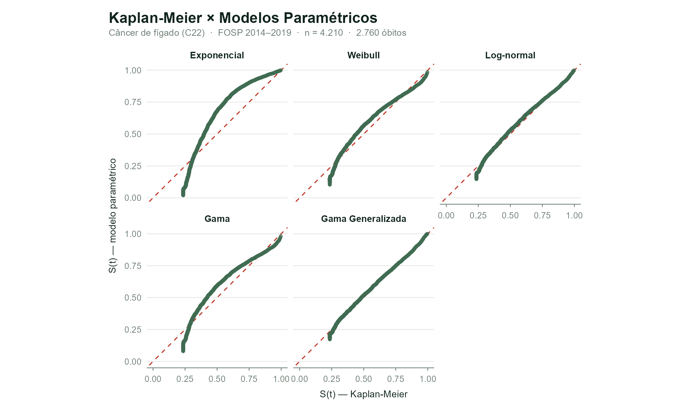
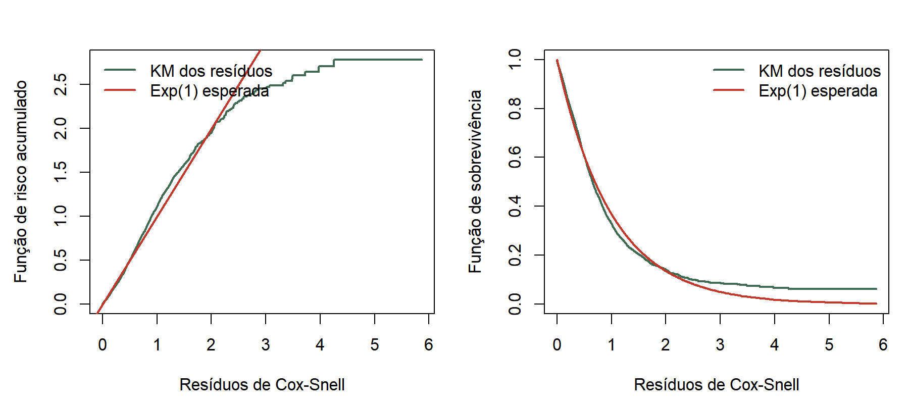
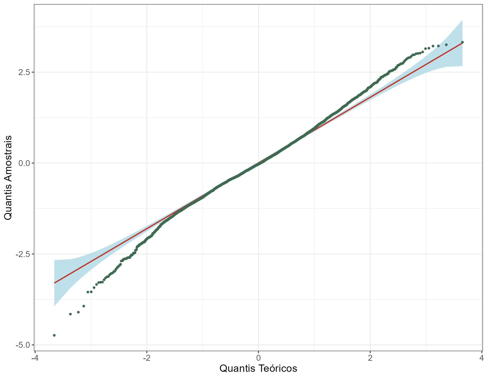

```{r}
#| include: false
base <- readRDS("data/base_analitica.RDS")
med  <- format(round(base$mediana_km, 1), decimal.mark = ",")
```

# Introdução

## Retomada da Parte I

:::: {.columns}
::: {.column width="49%"}
<div class="c-g">
<h3 class="ttl">O que a Parte I estabeleceu</h3>
<div style="display:grid; grid-template-columns:1fr 1fr; gap:12px;">
<div class="in-g"><div class="lbl">👥 Pacientes</div><div class="big" style="color:#3f6b52;">4.231</div><div class="sub">C22 · FOSP · 2014–2019</div></div>
<div class="in-g"><div class="lbl">💀 Óbitos por câncer</div><div class="big" style="color:#3f6b52;">2.774</div><div class="sub">65,6% · evento de interesse</div></div>
<div class="in-g"><div class="lbl">⏱️ Mediana global</div><div class="big" style="color:#3f6b52;">13,9</div><div class="sub">meses de sobrevida</div></div>
<div class="in-g"><div class="lbl">🚫 Censuras</div><div class="big" style="color:#3f6b52;">1.457</div><div class="sub">34,4% · sem óbito por câncer</div></div>
</div>
</div>
:::
::: {.column width="2%"}
:::
::: {.column width="49%"}
<div class="c-d">
<h3 class="ttl">Por que uma Parte II?</h3>
<div class="in-d"><div class="lbl">Parte I</div><div class="txt">Análise <b>univariada e não paramétrica</b>: estadiamento, escolaridade e cirurgia separaram as curvas.</div></div>
<div class="in-d"><div class="lbl">Limite</div><div class="txt">Cada fator foi avaliado isoladamente; os efeitos <b>se sobrepõem</b> e não foram separados entre si.</div></div>
<div class="in-d"><div class="lbl">Pergunta da Parte II</div><div class="txt">Qual <b>distribuição</b> descreve o tempo até o óbito e quais <b>covariáveis</b> continuam importantes quando analisadas em conjunto?</div></div>
</div>
:::
::::

## Objetivo e Roteiro

:::: {.columns}
::: {.column width="49%"}
<div class="c-g">
<div class="item"><div class="num">I</div><h3 class="ttl">Sem covariáveis</h3></div>
<div class="txt"><b>Qual distribuição</b> descreve o tempo até o óbito por câncer de fígado?</div>
<div style="display:flex; flex-wrap:wrap; gap:8px;">
<span class="pill">Exponencial</span><span class="pill">Weibull</span><span class="pill">Log-normal</span><span class="pill">Gama</span><span class="pill">Gama Generalizada</span>
</div>
<div class="sub">Escolha por gráficos, AIC/BIC e Teste da Razão de Verossimilhanças</div>
</div>
:::
::: {.column width="2%"}
:::
::: {.column width="49%"}
<div class="c-d">
<div class="item"><div class="num num-d">II</div><h3 class="ttl">Com covariáveis</h3></div>
<div class="txt"><b>Quais fatores</b> permanecem no modelo e <b>quanto</b> mudam o tempo de sobrevida?</div>
<div style="display:flex; flex-wrap:wrap; gap:8px;">
<span class="pill pill-d">Seleção de variáveis</span><span class="pill pill-d">Diagnóstico</span><span class="pill pill-d">Razão de tempos medianos</span>
</div>
<div class="sub">Interpretação em termos de tempo mediano de sobrevida</div>
</div>
:::
::::

## Base Analítica da Parte II

:::: {.columns}
::: {.column width="49%"}
<div class="c-g">
<h3 class="ttl">População de análise</h3>
<div style="display:grid; grid-template-columns:1fr 1fr; gap:12px;">
<div class="in-g"><div class="lbl">👥 n analítico</div><div class="big" style="color:#3f6b52;">4.210</div><div class="sub">mesma amostra em todos os ajustes</div></div>
<div class="in-g"><div class="lbl">💀 Óbitos por câncer</div><div class="big" style="color:#3f6b52;">2.760</div><div class="sub">65,6% · evento de interesse</div></div>
<div class="in-g"><div class="lbl">🚫 Censuras</div><div class="big" style="color:#3f6b52;">1.450</div><div class="sub">34,4% · sem óbito por câncer</div></div>
<div class="in-g"><div class="lbl">⏱️ Mediana (KM)</div><div class="big" style="color:#3f6b52;">`r med`</div><div class="sub">meses de sobrevida</div></div>
</div>
</div>
:::
::: {.column width="2%"}
:::
::: {.column width="49%"}
<div class="c-d">
<h3 class="ttl">Decisões de base</h3>
<div class="in-d"><div class="lbl">Tempo = 0</div><div class="txt">Removidos <b>21 pacientes</b> com tempo de seguimento igual a zero (14 óbitos e 7 censuras).</div></div>
<div class="in-d"><div class="lbl">Dados ausentes</div><div class="txt">"Sem informação" (ESCOLARI/ECGRUP) e "Não se aplica" (ECGRUP) <b>mantidos como categorias próprias</b>, preservando o n.</div></div>
<div class="in-d"><div class="lbl">Sensibilidade</div><div class="txt">Reajuste em <b>casos completos</b> ao final, para verificar a estabilidade das conclusões.</div></div>
</div>
:::
::::

# Metodologia

## Etapa I · Escolha da Distribuição

:::: {.columns}
::: {.column width="49%"}
<div class="c-g">
<h3 class="ttl">Modelos ajustados</h3>
<div class="in-g item"><div class="num">1</div><div style="flex:1;"><span class="fn">dist = "exponential"</span> <b class="txt">Exponencial</b></div></div>
<div class="in-g item"><div class="num">2</div><div style="flex:1;"><span class="fn">dist = "weibull"</span> <b class="txt">Weibull</b></div></div>
<div class="in-g item"><div class="num">3</div><div style="flex:1;"><span class="fn">dist = "lnorm"</span> <b class="txt">Log-normal</b></div></div>
<div class="in-g item"><div class="num">4</div><div style="flex:1;"><span class="fn">dist = "gamma"</span> <b class="txt">Gama</b></div></div>
<div class="in-g item"><div class="num">5</div><div style="flex:1;"><span class="fn">dist = "gengamma"</span> <b class="txt">Gama Generalizada</b></div></div>
<div class="sub">Todos ajustados com <span class="fn">flexsurvreg()</span></div>
</div>
:::
::: {.column width="2%"}
:::
::: {.column width="49%"}
<div class="c-d">
<h3 class="ttl">Critérios de escolha</h3>
<div class="in-d"><div class="txt"><b>Kaplan-Meier × modelo</b> · pontos próximos da diagonal indicam bom ajuste</div></div>
<div class="in-d"><div class="txt"><b>Linearização</b> · reta indica adequação (Exponencial, Weibull, Log-normal)</div></div>
<div class="in-d"><div class="txt"><b>AIC e BIC</b> · menor valor, ajuste penalizado pela complexidade</div></div>
<div class="in-d"><div class="txt"><b>TRV</b> · cada modelo contra a Gama Generalizada (modelos aninhados)</div></div>
<div class="sub">A decisão combina os quatro critérios; em caso de dúvida, o modelo mais simples</div>
</div>
:::
::::

## Etapa II · Seleção de Variáveis

<div class="c-k" style="margin-bottom:14px;">
<div class="lbl" style="color:#d9b054;">Os 5 passos de seleção · TRV a 10%</div>
</div>
<div class="fluxo">
<div class="passo"><div class="lbl">Passo 1</div><div class="txt"><b>Uma a uma</b> contra o modelo nulo</div></div>
<div class="seta">▶</div>
<div class="passo"><div class="lbl">Passo 2</div><div class="txt"><b>Modelo múltiplo</b>, retirando uma por vez</div></div>
<div class="seta">▶</div>
<div class="passo"><div class="lbl">Passo 3</div><div class="txt"><b>Reentrada</b> das descartadas</div></div>
<div class="seta">▶</div>
<div class="passo"><div class="lbl">Passo 4</div><div class="txt"><b>Reavaliação</b> das excluídas no passo 1</div></div>
<div class="seta">▶</div>
<div class="passo"><div class="lbl">Passo 5</div><div class="txt"><b>Interações</b> (até duas)</div></div>
</div>
<div style="height:14px;"></div>
:::: {.columns}
::: {.column width="49%"}
<div class="c-g">
<h3 class="ttl">Antes do passo 1</h3>
<div class="in-g"><div class="txt"><b>Filtro:</b> p &lt; 0,25 no Log-Rank ou no Peto-Peto</div></div>
<div class="in-g"><div class="txt"><b>Candidatas:</b> 6, com justificativa clínica</div></div>
<div class="in-g"><div class="txt"><b>Ajuste inicial:</b> Gama Generalizada, depois trocada pela distribuição escolhida</div></div>
<div class="in-g"><div class="txt"><b>Mesma amostra</b> em todos os modelos comparados</div></div>
</div>
:::
::: {.column width="2%"}
:::
::: {.column width="49%"}
<div class="c-d">
<h3 class="ttl">Regra de decisão</h3>
<div class="in-d"><div class="txt"><b>TRV</b> com p &lt; 0,10 mantém a variável</div></div>
<div class="in-d"><div class="txt"><b>AIC / BIC</b> como apoio; o BIC prioriza a parcimônia</div></div>
<div class="in-d"><div class="txt"><b>Magnitude do efeito</b> (RTM) e relevância prática: com amostra grande, p pequeno aparece mesmo com efeito pequeno</div></div>
</div>
:::
::::

## Etapa II · Avaliação e Interpretação

:::: {.columns}
::: {.column width="32%"}
<div class="c-g">
<h3 class="ttl">Distribuição final</h3>
<div class="in-g"><div class="txt">Mesmos critérios da Etapa I, agora <b>com covariáveis</b></div></div>
<div><span class="fn">$AIC</span> <span class="fn">$BIC</span> <span class="fn">TRV</span></div>
</div>
:::
::: {.column width="2%"}
:::
::: {.column width="32%"}
<div class="c-d">
<h3 class="ttl">Diagnóstico</h3>
<div class="in-d"><div class="txt"><b>Cox-Snell</b> · risco acumulado dos resíduos sobre a reta</div></div>
<div class="in-d"><div class="txt"><b>Quantílico aleatorizado</b> · qq-plot com banda de confiança</div></div>
</div>
:::
::: {.column width="2%"}
:::
::: {.column width="32%"}
<div class="c-g">
<h3 class="ttl">Interpretação</h3>
<div class="in-g"><div class="txt"><b>RTM</b> · razão de tempos medianos, com IC95%</div></div>
<div class="in-g"><div class="txt">Exponencial e Gama usam <span class="fn">exp(-coef)</span>; as demais <span class="fn">exp(coef)</span></div></div>
<div class="sub">IDADE reportada por 10 anos</div>
</div>
:::
::::

# Resultados

## Etapa I · Kaplan-Meier × Modelos

{height=510 fig-align="center"}

## Etapa I · Linearização

{width=100% fig-align="center"}

## Etapa I · AIC e BIC

:::: {.columns}
::: {.column width="40%"}
<div class="c-g">
<h3 class="ttl">Critérios de informação</h3>
<div class="lin lin-h" style="grid-template-columns:1.6fr 1fr 1fr;"><span>Modelo</span><span>AIC</span><span>BIC</span></div>
<div class="lin" style="grid-template-columns:1.6fr 1fr 1fr;"><span>Exponencial</span><b>25.344,7</b><b>25.351,0</b></div>
<div class="lin" style="grid-template-columns:1.6fr 1fr 1fr;"><span>Weibull</span><b>23.942,7</b><b>23.955,3</b></div>
<div class="lin" style="grid-template-columns:1.6fr 1fr 1fr;"><span>Log-normal</span><b>23.510,9</b><b>23.523,6</b></div>
<div class="lin" style="grid-template-columns:1.6fr 1fr 1fr;"><span>Gama</span><b>24.182,5</b><b>24.195,1</b></div>
<div class="lin" style="grid-template-columns:1.6fr 1fr 1fr; color:#d9b054;"><span><b>Gama Generalizada</b></span><b>23.469,4</b><b>23.488,5</b></div>
<div class="sub">Menor AIC e menor BIC: <b>Gama Generalizada</b></div>
</div>
:::
::: {.column width="2%"}
:::
::: {.column width="58%"}
{width=100% fig-align="center"}
:::
::::

## Etapa I · Teste da Razão de Verossimilhanças

<div class="c-d">
<h3 class="ttl">Cada modelo contra a Gama Generalizada</h3>
<div class="lin lin-h" style="grid-template-columns:1.6fr 1fr 0.6fr 1fr 1.4fr;"><span>Comparação</span><span>TRV</span><span>gl</span><span>p-valor</span><span>Decisão</span></div>
<div class="lin" style="grid-template-columns:1.6fr 1fr 0.6fr 1fr 1.4fr;"><span>Exponencial × GG</span><b>1.879,24</b><span>2</span><b>&lt; 0,001</b><span class="no">rejeitado</span></div>
<div class="lin" style="grid-template-columns:1.6fr 1fr 0.6fr 1fr 1.4fr;"><span>Weibull × GG</span><b>475,21</b><span>1</span><b>&lt; 0,001</b><span class="no">rejeitado</span></div>
<div class="lin" style="grid-template-columns:1.6fr 1fr 0.6fr 1fr 1.4fr;"><span>Log-normal × GG</span><b>43,44</b><span>1</span><b>&lt; 0,001</b><span class="no">rejeitado</span></div>
<div class="lin" style="grid-template-columns:1.6fr 1fr 0.6fr 1fr 1.4fr;"><span>Gama × GG</span><b>715,01</b><span>1</span><b>&lt; 0,001</b><span class="no">rejeitado</span></div>
<div class="sub">Com n = 4.210, o TRV detecta até desvios pequenos: <b>todos os modelos simples são rejeitados</b>. A log-normal é a mais próxima (TRV = 43,4), mas ainda inadequada → mantém-se a Gama Generalizada.</div>
</div>

## Etapa I · Distribuição Escolhida

:::: {.columns}
::: {.column width="49%"}
<div class="c-g">
<h3 class="ttl">Evidências</h3>
<div class="in-g item"><div class="num">1</div><div class="txt"><b>KM × modelo:</b> Gama Generalizada é a que mais se aproxima da diagonal; exponencial é a que mais desvia.</div></div>
<div class="in-g item"><div class="num">2</div><div class="txt"><b>Linearização:</b> exponencial claramente fora da reta; Weibull e log-normal mais próximas, porém com desvios nas caudas.</div></div>
<div class="in-g item"><div class="num">3</div><div class="txt"><b>AIC / BIC:</b> menores valores para a Gama Generalizada.</div></div>
<div class="in-g item"><div class="num">4</div><div class="txt"><b>TRV:</b> todos os modelos simples rejeitados (p &lt; 0,001).</div></div>
</div>
:::
::: {.column width="2%"}
:::
::: {.column width="49%"}
<div class="c-k" style="height:100%; display:flex; flex-direction:column; gap:10px; justify-content:center;">
<div class="lbl" style="color:#d9b054;">Distribuição escolhida</div>
<div style="font-size:1.6em; font-weight:800; color:#ffffff;">Gama Generalizada</div>
<div style="font-size:0.58em; color:#cfe0d5; line-height:1.4;">Q = −0,42 (IC95% −0,54 a −0,29) · forma de risco flexível, não constante; engloba as demais distribuições como casos particulares. Mortalidade concentrada nos primeiros meses após o diagnóstico.</div>
</div>
:::
::::

## Etapa II · Covariáveis Candidatas

<div class="c-g">
<div class="lin lin-h" style="grid-template-columns:1.1fr 2.8fr 0.9fr 0.9fr;"><span>Variável</span><span>Justificativa clínica</span><span>Log-Rank</span><span>Peto-Peto</span></div>
<div class="lin" style="grid-template-columns:1.1fr 2.8fr 0.9fr 0.9fr;"><b>ECGRUP</b><span>Extensão da doença no diagnóstico; maior separador na Parte I</span><span>&lt; 0,001</span><span>&lt; 0,001</span></div>
<div class="lin" style="grid-template-columns:1.1fr 2.8fr 0.9fr 0.9fr;"><b>CIRURGIA</b><span>Único tratamento potencialmente curativo</span><span>&lt; 0,001</span><span>&lt; 0,001</span></div>
<div class="lin" style="grid-template-columns:1.1fr 2.8fr 0.9fr 0.9fr;"><b>QUIMIO</b><span>Tratamento sistêmico; curvas se cruzam na Parte I</span><span>&lt; 0,001</span><span>&lt; 0,001</span></div>
<div class="lin" style="grid-template-columns:1.1fr 2.8fr 0.9fr 0.9fr;"><b>ESCOLARI</b><span>Marcador de acesso a diagnóstico e cuidado</span><span>&lt; 0,001</span><span>&lt; 0,001</span></div>
<div class="lin" style="grid-template-columns:1.1fr 2.8fr 0.9fr 0.9fr;"><b>SEXO</b><span>Diferença modesta na Parte I</span><span>0,046</span><span>0,049</span></div>
<div class="lin" style="grid-template-columns:1.1fr 2.8fr 0.9fr 0.9fr;"><b>IDADE</b><span>Quantitativa; entra por justificativa clínica (por 10 anos)</span><span>—</span><span>—</span></div>
<div class="sub">Não candidatas: <b>RADIO</b> (188 tratados, 4,4%) e <b>CATEATEND</b> (Particular com 75 casos), por justificativa clínica. "Sem informação"/"Não se aplica" mantidos como categorias. Todas as candidatas passam no filtro de 0,25.</div>
</div>

## Etapa II · Passos 1 e 2

:::: {.columns}
::: {.column width="49%"}
<div class="c-g">
<h3 class="ttl">Passo 1 · uma variável por vez</h3>
<div class="lin lin-h" style="grid-template-columns:1.4fr 1fr 1fr;"><span>Variável</span><span>p (TRV)</span><span>Decisão</span></div>
<div class="lin" style="grid-template-columns:1.4fr 1fr 1fr;"><span>ECGRUP</span><b>&lt; 0,001</b><span class="ok">entra</span></div>
<div class="lin" style="grid-template-columns:1.4fr 1fr 1fr;"><span>CIRURGIA</span><b>&lt; 0,001</b><span class="ok">entra</span></div>
<div class="lin" style="grid-template-columns:1.4fr 1fr 1fr;"><span>QUIMIO</span><b>&lt; 0,001</b><span class="ok">entra</span></div>
<div class="lin" style="grid-template-columns:1.4fr 1fr 1fr;"><span>ESCOLARI</span><b>&lt; 0,001</b><span class="ok">entra</span></div>
<div class="lin" style="grid-template-columns:1.4fr 1fr 1fr;"><span>SEXO</span><b>0,113</b><span class="no">não entra</span></div>
<div class="lin" style="grid-template-columns:1.4fr 1fr 1fr;"><span>IDADE10</span><b>&lt; 0,001</b><span class="ok">entra</span></div>
</div>
:::
::: {.column width="2%"}
:::
::: {.column width="49%"}
<div class="c-d">
<h3 class="ttl">Passo 2 · modelo múltiplo</h3>
<div class="lin lin-h" style="grid-template-columns:1.4fr 1fr 1fr;"><span>Variável retirada</span><span>p (TRV)</span><span>Decisão</span></div>
<div class="lin" style="grid-template-columns:1.4fr 1fr 1fr;"><span>ECGRUP</span><b>&lt; 0,001</b><span class="ok">fica</span></div>
<div class="lin" style="grid-template-columns:1.4fr 1fr 1fr;"><span>CIRURGIA</span><b>&lt; 0,001</b><span class="ok">fica</span></div>
<div class="lin" style="grid-template-columns:1.4fr 1fr 1fr;"><span>QUIMIO</span><b>&lt; 0,001</b><span class="ok">fica</span></div>
<div class="lin" style="grid-template-columns:1.4fr 1fr 1fr;"><span>ESCOLARI</span><b>&lt; 0,001</b><span class="ok">fica</span></div>
<div class="lin" style="grid-template-columns:1.4fr 1fr 1fr;"><span>IDADE10</span><b>0,042</b><span class="ok">fica</span></div>
<div class="sub">Nenhuma variável sai no passo 2.</div>
</div>
:::
::::

## Etapa II · Passos 3 a 5

:::: {.columns}
::: {.column width="49%"}
<div class="c-g">
<h3 class="ttl">Passos 3 e 4 · reentrada e reavaliação</h3>
<div class="in-g"><div class="txt"><b>Passo 3 — reentrada das descartadas:</b> nada a reentrar (nenhuma variável saiu no passo 2).</div></div>
<div class="in-g"><div class="txt"><b>Passo 4 — reavaliação das excluídas no passo 1:</b> SEXO com p (TRV) = 0,914 → <span class="no">não entra</span>. O efeito marginal do sexo desaparece após ajuste.</div></div>
</div>
:::
::: {.column width="2%"}
:::
::: {.column width="49%"}
<div class="c-d">
<h3 class="ttl">Passo 5 · interações (até duas)</h3>
<div class="in-d"><div class="txt"><b>ECGRUP × CIRURGIA</b> · cirurgia em 49% no estágio I e 11% no IV</div><div class="sub">TRV = 27,52 (gl 5) · p &lt; 0,001 → <span class="ok">entra</span></div></div>
<div class="in-d"><div class="txt"><b>ECGRUP × QUIMIO</b> · quimioterapia em 27% nos estágios I/II e 47% no IV</div><div class="sub">TRV = 93,18 (gl 5) · p &lt; 0,001 → <span class="ok">entra</span></div></div>
</div>
:::
::::

## Etapa II · Modelo Selecionado

:::: {.columns}
::: {.column width="32%"}
<div class="c-g">
<h3 class="ttl">Permaneceram</h3>
<div class="txt" style="display:flex; flex-direction:column; gap:7px; font-size:0.55em;">
<div><b>ECGRUP</b> — principal fator prognóstico</div>
<div><b>CIRURGIA</b> — tratamento curativo</div>
<div><b>QUIMIO</b> — efeito depende do estágio</div>
<div><b>ESCOLARI</b> — acesso a cuidado</div>
<div><b>IDADE10</b> — limítrofe (p = 0,064), mantida pelo protocolo a 10%</div>
</div>
</div>
:::
::: {.column width="2%"}
:::
::: {.column width="32%"}
<div class="c-d">
<h3 class="ttl">Saíram</h3>
<div class="txt" style="display:flex; flex-direction:column; gap:7px; font-size:0.55em;">
<div><b>SEXO</b> — passo 1 (p = 0,113); não reentrou no passo 4 (p = 0,914)</div>
<div><b>RADIO / CATEATEND</b> — fora por justificativa clínica</div>
</div>
</div>
:::
::: {.column width="2%"}
:::
::: {.column width="32%"}
<div class="c-g">
<h3 class="ttl">Interações</h3>
<div class="txt" style="display:flex; flex-direction:column; gap:7px; font-size:0.55em;">
<div><b>ECGRUP × CIRURGIA</b> (p &lt; 0,001)</div>
<div><b>ECGRUP × QUIMIO</b> (p &lt; 0,001)</div>
</div>
<div class="sub">26 parâmetros · Gama Generalizada</div>
</div>
:::
::::

## Etapa II · Reavaliação na Distribuição Final

<div class="c-d">
<h3 class="ttl">Retirada de cada termo (hierarquia respeitada)</h3>
<div class="lin lin-h" style="grid-template-columns:1.8fr 1fr 0.6fr 1fr 1fr 1fr;"><span>Termo</span><span>TRV</span><span>gl</span><span>p-valor</span><span>ΔAIC</span><span>ΔBIC</span></div>
<div class="lin" style="grid-template-columns:1.8fr 1fr 0.6fr 1fr 1fr 1fr;"><span>ESCOLARI</span><b>42,02</b><span>5</span><b>&lt; 0,001</b><span>+32,0</span><span>+0,3</span></div>
<div class="lin" style="grid-template-columns:1.8fr 1fr 0.6fr 1fr 1fr 1fr;"><span>IDADE10</span><b>3,43</b><span>1</span><b>0,064</b><span>+1,4</span><span>−4,9</span></div>
<div class="lin" style="grid-template-columns:1.8fr 1fr 0.6fr 1fr 1fr 1fr;"><span>ECGRUP × CIRURGIA</span><b>21,09</b><span>5</span><b>&lt; 0,001</b><span>+11,1</span><span>−20,6</span></div>
<div class="lin" style="grid-template-columns:1.8fr 1fr 0.6fr 1fr 1fr 1fr;"><span>ECGRUP × QUIMIO</span><b>86,75</b><span>5</span><b>&lt; 0,001</b><span>+76,8</span><span>+45,0</span></div>
<div class="sub">ΔAIC/ΔBIC &gt; 0: retirar o termo piora o ajuste. O BIC retiraria IDADE10 e ECGRUP×CIRURGIA, mas o <b>TRV a 10% os mantém</b>. Efeitos principais de ECGRUP, CIRURGIA e QUIMIO são protegidos pela hierarquia (não saem isoladamente).</div>
</div>

## Etapa II · Distribuição com Covariáveis

<div class="c-d">
<h3 class="ttl">Modelo com as covariáveis selecionadas</h3>
<div class="lin lin-h" style="grid-template-columns:1.6fr 1fr 1fr 1fr 1.4fr;"><span>Modelo</span><span>AIC</span><span>BIC</span><span>p (TRV × GG)</span><span>Decisão</span></div>
<div class="lin" style="grid-template-columns:1.6fr 1fr 1fr 1fr 1.4fr;"><span>Exponencial</span><b>22.214,9</b><b>22.367,2</b><b>&lt; 0,001</b><span class="no">rejeitado</span></div>
<div class="lin" style="grid-template-columns:1.6fr 1fr 1fr 1fr 1.4fr;"><span>Weibull</span><b>21.801,5</b><b>21.960,2</b><b>&lt; 0,001</b><span class="no">rejeitado</span></div>
<div class="lin" style="grid-template-columns:1.6fr 1fr 1fr 1fr 1.4fr;"><span>Log-normal</span><b>21.500,6</b><b>21.659,2</b><b>0,0002</b><span class="no">rejeitado</span></div>
<div class="lin" style="grid-template-columns:1.6fr 1fr 1fr 1fr 1.4fr;"><span>Gama</span><b>21.960,2</b><b>22.118,8</b><b>&lt; 0,001</b><span class="no">rejeitado</span></div>
<div class="lin" style="grid-template-columns:1.6fr 1fr 1fr 1fr 1.4fr; color:#d9b054;"><span><b>Gama Generalizada</b></span><b>21.488,8</b><b>21.653,8</b><b>—</b><span>referência</span></div>
<div class="sub">A log-normal é a mais próxima (ΔAIC = 11,7; TRV = 13,7), mas rejeitada a 5%. <b>Distribuição final: Gama Generalizada</b> (Q = 0,17; IC95% 0,08–0,26), coerente com a Etapa I.</div>
</div>

## Etapa II · Diagnóstico

:::: {.columns}
::: {.column width="49%"}
<div class="lbl" style="margin-bottom:6px;">Resíduos de Cox-Snell</div>
{width=100%}
:::
::: {.column width="2%"}
:::
::: {.column width="49%"}
<div class="lbl" style="margin-bottom:6px;">Resíduos quantílicos aleatorizados</div>
{width=100%}
:::
::::
<div class="sub" style="margin-top:10px;">Cox-Snell: a KM dos resíduos acompanha a referência Exp(1) (reta de 45° no risco acumulado), indicando adequação global; desvios na cauda direita refletem poucos pacientes em risco. Quantílicos: pontos dentro da banda, salvo eventuais desvios nas caudas. <b>QUIMIO:</b> as curvas se cruzam na Parte I — cautela com a hipótese de tempo acelerado; o efeito é lido por estágio (interação).</div>

## Etapa II · Razão de Tempos Medianos

{height=540 fig-align="center"}
<div class="sub">Referência: Estágio I · sem cirurgia · sem quimio · Analfabeto. Com interações, os efeitos principais valem na categoria de referência da outra variável.</div>

## Etapa II · Interpretando as Interações

:::: {.columns}
::: {.column width="49%"}
<div class="c-g">
<h3 class="ttl">Cirurgia (vs não) por estágio</h3>
<div class="lin lin-h" style="grid-template-columns:1.4fr 1fr;"><span>Estágio</span><span>RTM combinada</span></div>
<div class="lin" style="grid-template-columns:1.4fr 1fr;"><span>I</span><b>4,52</b></div>
<div class="lin" style="grid-template-columns:1.4fr 1fr;"><span>II</span><b>5,12</b></div>
<div class="lin" style="grid-template-columns:1.4fr 1fr;"><span>III</span><b>6,03</b></div>
<div class="lin" style="grid-template-columns:1.4fr 1fr;"><span>IV</span><b>2,77</b></div>
<div class="sub">Benefício da cirurgia em todos os estágios, porém <b>menor no IV</b>.</div>
</div>
:::
::: {.column width="2%"}
:::
::: {.column width="49%"}
<div class="c-d">
<h3 class="ttl">Quimioterapia (vs não) por estágio</h3>
<div class="lin lin-h" style="grid-template-columns:1.4fr 1fr;"><span>Estágio</span><span>RTM combinada</span></div>
<div class="lin" style="grid-template-columns:1.4fr 1fr;"><span>I</span><b>1,14</b></div>
<div class="lin" style="grid-template-columns:1.4fr 1fr;"><span>II</span><b>1,27</b></div>
<div class="lin" style="grid-template-columns:1.4fr 1fr;"><span>III</span><b>2,56</b></div>
<div class="lin" style="grid-template-columns:1.4fr 1fr;"><span>IV</span><b>3,90</b></div>
<div class="sub">Sem efeito no estágio I; associação crescente nos estágios avançados.</div>
</div>
:::
::::
<div class="sub" style="margin-top:8px;">RTM combinadas = produto dos efeitos (estimativas pontuais; IC requer a matriz de covariância). Demais efeitos: Estágio IV vs I = 0,05 (0,04–0,07) entre não tratados; Ensino superior vs Analfabeto = 1,90 (1,39–2,60); Idade (+10 anos) = 0,96 (0,92–1,00).</div>

## Etapa II · Perfis Previstos

:::: {.columns}
::: {.column width="58%"}
{width=100% fig-align="center"}
:::
::: {.column width="2%"}
:::
::: {.column width="40%"}
<div class="c-d">
<h3 class="ttl">Medianas previstas</h3>
<div class="in-d"><div class="lbl">Desfavorável</div><div class="txt">Estágio IV · sem cirurgia · sem quimio · Analfabeto · 70 anos → <b>≈ 2,0 meses</b> (IC95% 1,5–2,6).</div></div>
<div class="in-d"><div class="lbl">Favorável</div><div class="txt">Estágio I · cirurgia · quimio · Ensino superior · 56 anos → mediana <b>não atingida no seguimento</b> (modelo extrapola ≈ 384 meses).</div></div>
<div class="sub">Perfis extremos e ilustrativos; a mediana favorável é extrapolação além do acompanhamento — leitura apenas qualitativa do contraste.</div>
</div>
:::
::::

## Etapa II · Sensibilidade (casos completos)

<div class="c-g">
<h3 class="ttl">Reajuste sem "Sem informação" / "Não se aplica"</h3>
<div class="lin lin-h" style="grid-template-columns:1.8fr 1fr 1fr 1fr;"><span>Termo</span><span>RTM principal</span><span>RTM casos completos</span><span>Mesma direção</span></div>
<div class="lin" style="grid-template-columns:1.8fr 1fr 1fr 1fr;"><span>Estágio II</span><b>0,50</b><b>0,52</b><span class="ok">sim</span></div>
<div class="lin" style="grid-template-columns:1.8fr 1fr 1fr 1fr;"><span>Estágio III</span><b>0,12</b><b>0,15</b><span class="ok">sim</span></div>
<div class="lin" style="grid-template-columns:1.8fr 1fr 1fr 1fr;"><span>Estágio IV</span><b>0,05</b><b>0,07</b><span class="ok">sim</span></div>
<div class="lin" style="grid-template-columns:1.8fr 1fr 1fr 1fr;"><span>Cirurgia (Sim)</span><b>4,52</b><b>4,36</b><span class="ok">sim</span></div>
<div class="lin" style="grid-template-columns:1.8fr 1fr 1fr 1fr;"><span>Ensino superior</span><b>1,90</b><b>1,37</b><span class="ok">sim</span></div>
<div class="lin" style="grid-template-columns:1.8fr 1fr 1fr 1fr;"><span>Idade (+10 anos)</span><b>0,96</b><b>0,94</b><span class="ok">sim</span></div>
<div class="sub">Direção preservada em <b>todos os 16 termos</b>; magnitudes semelhantes (escolaridade superior atenua). Conclusões estáveis ao tratamento dos ausentes.</div>
</div>

# Conclusão

## Conclusão

<div class="c-k" style="margin-bottom:16px; border-left:4px solid #b8862a;">
<div style="font-size:0.7em; font-weight:600; color:#e8f0ea; line-height:1.55;">
A distribuição <b style="color:#d9b054;">Gama Generalizada</b> descreveu melhor o tempo até o óbito, e <b style="color:#d9b054;">estadiamento, cirurgia, quimioterapia (por estágio), escolaridade e idade</b> permaneceram associadas à sobrevida quando analisadas em conjunto.
</div>
</div>
:::: {.columns}
::: {.column width="32%"}
<div class="c-g">
<h3 class="ttl">Distribuição</h3>
<div class="txt" style="font-size:0.55em;">Gama Generalizada nas duas etapas (menor AIC/BIC; modelos simples rejeitados pelo TRV). Risco flexível, não constante; Q = 0,17 no modelo final.</div>
</div>
:::
::: {.column width="2%"}
:::
::: {.column width="32%"}
<div class="c-g">
<h3 class="ttl">Maiores efeitos</h3>
<div class="txt" style="display:flex; flex-direction:column; gap:7px; font-size:0.5em;">
<div>Estágio IV vs I (não tratados): <b>RTM 0,05</b> (0,04–0,07) · −95%</div>
<div>Cirurgia no Estágio I: <b>RTM 4,52</b> (3,23–6,32)</div>
<div>Ensino superior vs Analfabeto: <b>RTM 1,90</b> (1,39–2,60)</div>
<div>QUIMIO no Estágio IV: <b>≈ 3,9</b> (combinada)</div>
</div>
</div>
:::
::: {.column width="2%"}
:::
::: {.column width="32%"}
<div class="c-d">
<h3 class="ttl">Limitações</h3>
<div class="txt" style="display:flex; flex-direction:column; gap:7px; font-size:0.5em;">
<div>— Estudo observacional: associação não é causa</div>
<div>— Confundimento por indicação: quem opera ou faz quimioterapia já é um paciente selecionado</div>
<div>— RHC não é base populacional</div>
<div>— Dados ausentes em ESCOLARI e ECGRUP</div>
<div>— QUIMIO: curvas se cruzam; perfis extremos extrapolam o seguimento</div>
</div>
</div>
:::
::::

## Fim {.unnumbered .final-slide}

<div style="text-align:center; margin-top:12%;">
<div style="font-size:1.8em; font-weight:800; color:#d9b054;">Obrigado!</div>
<div style="font-size:0.7em; color:#cfe0d5; margin-top:10px;">Caio Salviano · caiosalviano@id.uff.br</div>
<div style="font-size:0.6em; color:#cfe0d5;">Universidade Federal Fluminense · Análise de Sobrevivência e Confiabilidade</div>
</div>